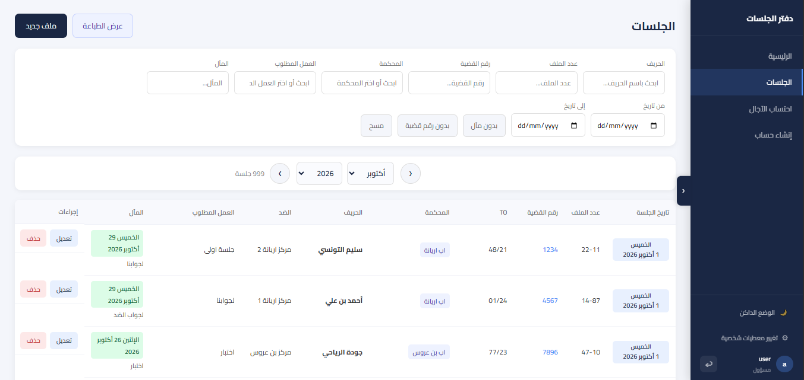
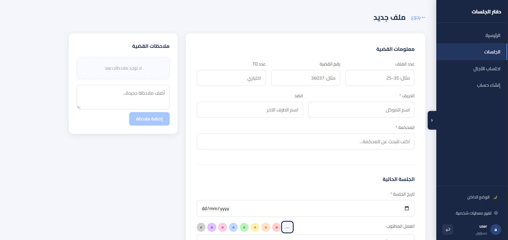
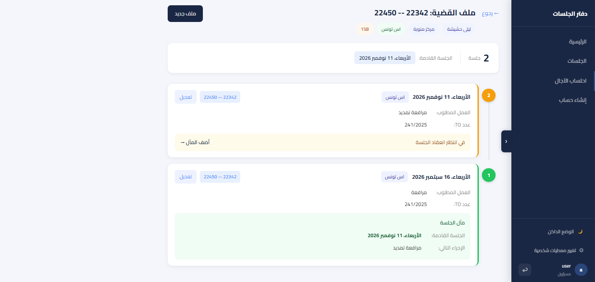
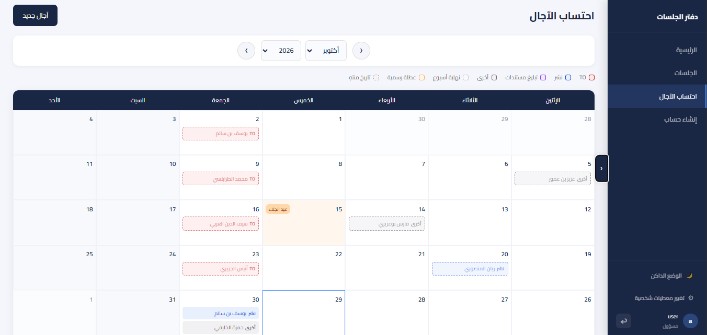

# Hearings — Court Hearing Management Web App

A full-stack web application built for a practicing lawyer and his secretary in Tunisia to **manage court hearings, calculate legal deadlines automatically, and sync their schedule to Google Calendar**.

 **Live app:** [hearings.netlify.app](https://hearings.netlify.app/)
> The app is private and requires an account, so you can't browse it without logging in. See the screenshots below for a full tour.

> **About the source code:** this was developed for a paying client, so the source repositories are private. This repository only contains the project presentation.

---

## The Problem

The law office was tracking all its hearings in **Excel** and calculating deadlines (*délais*) **by hand**. This caused:

- Inconsistent data between the lawyer and the secretary
- A lot of wasted time on repetitive calculations
- A real risk of mistakes on dates that matter legally

## The Solution

Hearings replaces the spreadsheet with a simple web app that both the lawyer and the secretary can use from any device. All hearings are stored in one place, deadlines are computed automatically, and upcoming hearings appear directly in Google Calendar on their phones.

The interface is **fully in Arabic**, since court cases in Tunisia are handled in Arabic.

---

## Features

- **Hearing management:** full CRUD (create, view, edit, delete hearings)
- **Filtering:** filter hearings by court
- **Case history:** every case keeps a complete history of its hearings
- **Automatic date calculation:** the app computes the next date and deadlines on its own, with no manual counting
- **Google Calendar export:** upcoming hearings sync to Google Calendar so the lawyer and the secretary can see them on their phones
- **Authentication:** only authorized users can access the data

---

## Tech Stack

| Layer | Technology |
|---|---|
| Frontend | Angular |
| Backend | Java, Spring Boot |
| Database | PostgreSQL |
| Frontend hosting | Netlify |
| Backend hosting | Render |
| Database hosting | Neon |

The whole project is deployed on free tiers.

---

## Screenshots

> *Client data in these screenshots has been replaced with fake data.*

| Hearings list | Add / edit a hearing |
|---|---|
|  |  |

| Case history | Calendar export |
|---|---|
|  |  |

---

## Architecture

```
 Angular                Spring Boot (Java)         PostgreSQL
 (Netlify)      ──REST──►  (Render)           ──────► (Neon)
      │
      └── Google Calendar export
```

---

## My Role

I designed, developed and deployed this project on my own, covering the frontend, the backend, the database and the deployment.

I used **AI tools as an assistant** during development, for example to speed up coding and debug problems. I was responsible for the design, the architecture, the integration and the deployment, and I understand how the whole system works.

---

## Contact

**Sabri Ben Boubaker**
GitHub: [@SabriBen49](https://github.com/SabriBen49)
LinkedIn: (https://www.linkedin.com/in/sabri-ben-boubaker/)
